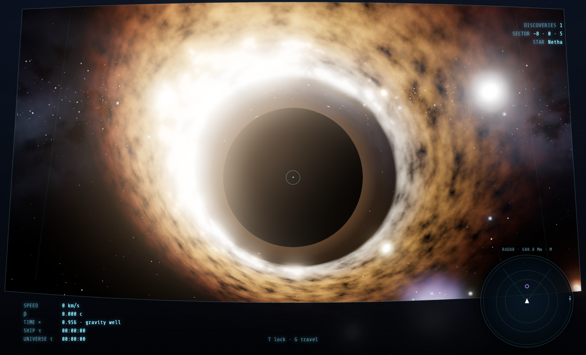

# Dark Holes

Two games about gravity and time:

- **Deep Space (3D, `index.html`)** — first-person exploration of an endless, procedurally generated universe. No goal, no game over: fly between star systems, chart worlds, fall into black holes.
- **Classic (2D, `classic.html`)** — the original minimalist vertical-corridor game. Also preserved untouched on the `classic-2d` branch.

Runs in any modern browser — no build step.

<p align="center">
  
  &nbsp;
  
</p>

## Deep Space (3D)

You start in orbit around a terran world in your home system. Everything else is out there.

### Controls

| Action | Key |
|---|---|
| Pitch / yaw | Mouse (click to capture) or arrow keys |
| Roll | `Q` / `E` |
| Thrust / reverse | `W` / `S` |
| Strafe / vertical | `A` / `D` · `R` / `F` |
| Warp drive | hold `Shift` while thrusting |
| Brake | `Space` |
| Lock target under the reticle | `T` |
| Autopilot to target | `G` |
| Radar range | `M` |
| Cockpit frame · sound · help | `C` · `V` · `H` |
| Beacon back to the home system | `B` |

### What's out there

- **Star systems** — yellow, orange and red dwarfs, white stars, blue giants. Rocky, terran (oceans, clouds, city lights on the night side), gas giants with rings, lava and ice worlds, moons, asteroid belts. Everything orbits in real time.
- **Black holes** — accretion disk with Doppler beaming and real-time gravitational lensing. Cross the horizon and you get thrown somewhere far away.
- **Wormholes** — fly through to jump to a distant system.
- **Nebulae** — huge glowing clouds you can fly into.
- The universe is deterministic (fixed seed) and flattens into a galactic disk: fly far up or down and it thins out.

### Flight model

- Newtonian gravity from every body; near a planet you co-move with it so it doesn't drift away.
- **Mass lock**: top speed shrinks near massive bodies, so warp is for open space and you can't smash into a planet at 400,000 km/s.
- **Time**: the HUD shows ship proper time τ vs universe time t. `TIME ×` combines special-relativistic dilation (speed vs the game's c) and gravitational dilation near black holes.
- **Discoveries**: getting close to a body charts it. Discoveries and your position are saved in `localStorage`.

### HUD

Speed, β (fraction of c), time dilation, proper time, discoveries, current sector and nearest star. The target bracket shows name, type and distance. The radar (bottom right) is ship-relative and square-root scaled; stalks show how far above/below you each body is.

## Classic (2D)

### Play

- **Online:** published on itch.io.
- **Locally:** serve the folder (the 3D version uses ES modules, so `file://` won't work):

  ```bash
  python3 -m http.server 8000
  # 3D:      http://localhost:8000
  # classic: http://localhost:8000/classic.html
  ```

### Goal & scoring

- Reach the **FINISH** line at the top of the level.
- The score is your **proper time τ** — the time elapsed *on the ship's clock*, not on the universe's clock. Lower is better.
- Near black holes your clock runs slower (gravitational time dilation, shown in the HUD as `TIME ×`). Diving close to a black hole lowers τ, but gets you closer to the event horizon.
- The best τ for each difficulty is shown in the menu (kept for the current session).

### Controls

| Action | Keyboard | Touch |
|---|---|---|
| Rotate | `←` / `→` | tap bottom-left / bottom-right |
| Thrust | `W` / `Space` / `↑` | tap upper part of the screen |
| Retro thrust | `S` / `↓` | tap bottom-center |
| Retry | `R` | — |
| Next difficulty | `N` | — |
| Back to menu | `L` / `M` | — |
| Pause | `P` | — |

### HUD

- **LIFE** — hull health (150 max). Reaching 0 wrecks the ship.
- **TIME** — proper time τ on the ship's clock.
- **SPEED** — current speed in px/s.
- **TIME ×** — current time-dilation factor (1.00 = flat space).
- **↑ m** — distance left to the finish, with a progress bar at the top.
- **SHIELD** — after a hit you get 4 s of invulnerability: you bounce off bodies instead of taking damage.

### Physics

- **Gravity:** every massive body pulls the ship with Newtonian `a = G·M / r²`. Pulsing rings around bodies mark their zones of influence.
- **Time dilation:** `τ-rate = √(1 − Σ rₛ / d)` summed over all black holes, where `rₛ` is the Schwarzschild radius and `d` the distance. Cross a horizon and your clock stops.
- **Collisions:** hitting a planet, asteroid, comet, star or black hole costs life and launches you away from the body. Damage: star −20, black hole −18, planet −10, asteroid / comet −6.
- **Wormholes:** come in linked pairs; entering one teleports you to its twin, keeping your heading (3 s cooldown).
- **Orbits:** planets, moons and asteroid belts orbit their parents in real time, so the level is never static.

### Difficulties

Levels are procedurally generated from a random seed every run.

| Mode | Contents |
|---|---|
| **Tutorial** | Quiet space, planets and a few belts. Learn the controls. |
| **Easy** | Planets, belts, stray comets, one solar system. |
| **Medium** | Stars, ringed worlds, wormholes. Denser. |
| **Hard** | Black holes, nebulae, star clusters. |
| **Extreme** | Everything, everywhere, all at once. |
| **Infinite** | Free flight in an endless, chunk-generated universe. No finish line. |

### Options

- **Ship skin:** Navy, Hazard (black & yellow), Steel.
- **Display:** `9:16` portrait letterbox, or `FULL` to fill the window.

Both choices are saved in `localStorage`.

## Project structure

```
index.html   # Deep Space (3D): page shell, HUD, cockpit overlay
game3d.js    # Deep Space: universe generation, shaders, flight, radar, audio (three.js r160 from CDN)
classic.html # classic 2D page shell
styles.css   # classic: layout, menu and touch-control styling
game.js      # classic: the whole 2D game (bundled)
docs/        # screenshots used in this README
```

## Publishing on itch.io

itch.io expects a ZIP with `index.html` at its root. From the repo folder:

```bash
zip -r dark-holes.zip index.html game3d.js classic.html styles.css game.js
```

Upload `dark-holes.zip` as an HTML project and tick *"This file will be played in the browser"*. The 3D version loads three.js and fonts from a CDN, so it needs a network connection.
