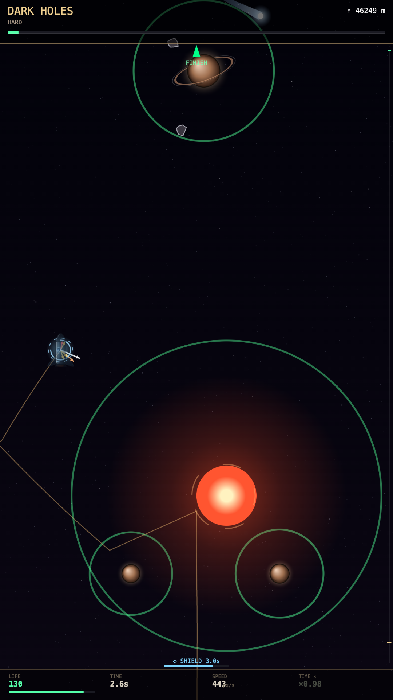
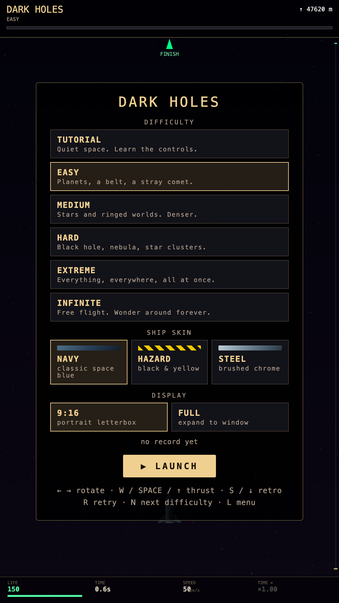

# Dark Holes

A minimalist space-flight game about gravity and time. Pilot a small ship from the bottom of a long vertical corridor to the **FINISH** line at the top, slingshotting around planets, stars and black holes. The catch: every massive body bends your path, and black holes slow down your clock.

Runs in any modern browser — no build step, no dependencies.

<p align="center">
  
  &nbsp;&nbsp;
  
</p>

## Play

- **Online:** published on itch.io.
- **Locally:** open `index.html` in a browser, or serve the folder:

  ```bash
  python3 -m http.server 8000
  # then open http://localhost:8000
  ```

## Goal & scoring

- Reach the **FINISH** line at the top of the level.
- The score is your **proper time τ** — the time elapsed *on the ship's clock*, not on the universe's clock. Lower is better.
- Near black holes your clock runs slower (gravitational time dilation, shown in the HUD as `TIME ×`). Diving close to a black hole lowers τ, but gets you closer to the event horizon.
- The best τ for each difficulty is shown in the menu (kept for the current session).

## Controls

| Action | Keyboard | Touch |
|---|---|---|
| Rotate | `←` / `→` | tap bottom-left / bottom-right |
| Thrust | `W` / `Space` / `↑` | tap upper part of the screen |
| Retro thrust | `S` / `↓` | tap bottom-center |
| Retry | `R` | — |
| Next difficulty | `N` | — |
| Back to menu | `L` / `M` | — |
| Pause | `P` | — |

## HUD

- **LIFE** — hull health (150 max). Reaching 0 wrecks the ship.
- **TIME** — proper time τ on the ship's clock.
- **SPEED** — current speed in px/s.
- **TIME ×** — current time-dilation factor (1.00 = flat space).
- **↑ m** — distance left to the finish, with a progress bar at the top.
- **SHIELD** — after a hit you get 4 s of invulnerability: you bounce off bodies instead of taking damage.

## Physics

- **Gravity:** every massive body pulls the ship with Newtonian `a = G·M / r²`. Pulsing rings around bodies mark their zones of influence.
- **Time dilation:** `τ-rate = √(1 − Σ rₛ / d)` summed over all black holes, where `rₛ` is the Schwarzschild radius and `d` the distance. Cross a horizon and your clock stops.
- **Collisions:** hitting a planet, asteroid, comet, star or black hole costs life and launches you away from the body. Damage: star −20, black hole −18, planet −10, asteroid / comet −6.
- **Wormholes:** come in linked pairs; entering one teleports you to its twin, keeping your heading (3 s cooldown).
- **Orbits:** planets, moons and asteroid belts orbit their parents in real time, so the level is never static.

## Difficulties

Levels are procedurally generated from a random seed every run.

| Mode | Contents |
|---|---|
| **Tutorial** | Quiet space, planets and a few belts. Learn the controls. |
| **Easy** | Planets, belts, stray comets, one solar system. |
| **Medium** | Stars, ringed worlds, wormholes. Denser. |
| **Hard** | Black holes, nebulae, star clusters. |
| **Extreme** | Everything, everywhere, all at once. |
| **Infinite** | Free flight in an endless, chunk-generated universe. No finish line. |

## Options

- **Ship skin:** Navy, Hazard (black & yellow), Steel.
- **Display:** `9:16` portrait letterbox, or `FULL` to fill the window.

Both choices are saved in `localStorage`.

## Project structure

```
index.html   # page shell: canvas, HUD and overlay containers
styles.css   # layout, menu and touch-control styling
game.js      # the whole game (bundled): level generation, physics, rendering, input
docs/        # screenshots used in this README
```

## Publishing on itch.io

itch.io expects a ZIP with `index.html` at its root. From the repo folder:

```bash
zip -r dark-holes.zip index.html styles.css game.js
```

Upload `dark-holes.zip` as an HTML project and tick *"This file will be played in the browser"*.
