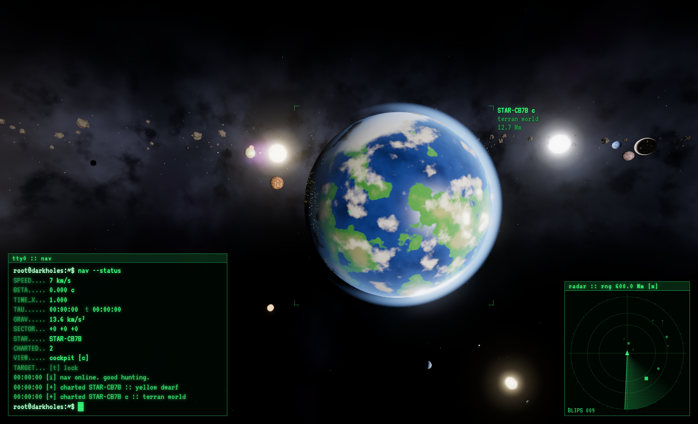
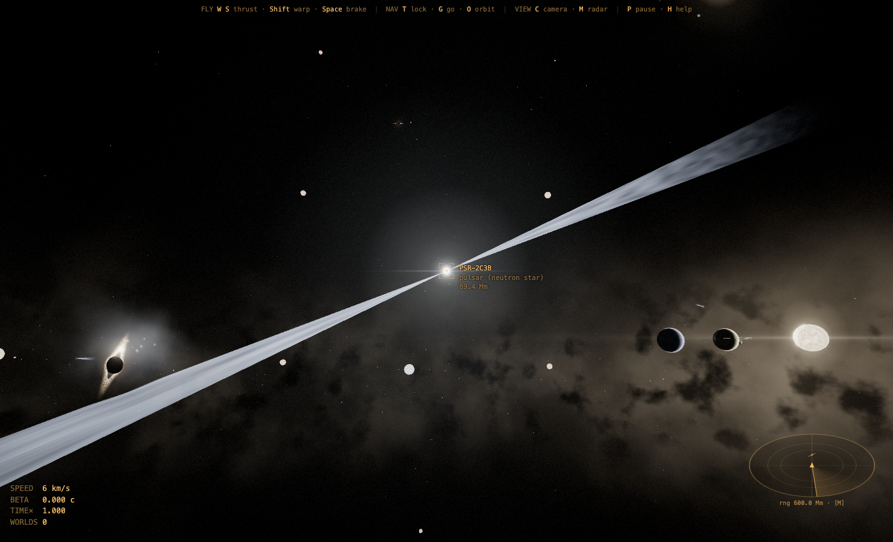

# Dark Holes

An endless, procedurally generated universe to explore from the cockpit of your ship: a Dream Chaser-style lifting body, a shuttle orbiter, an Orion-style capsule with its service module, a Starship-style steel ship or a retro rocket. No goal, no game over: fly between star systems, orbit strange worlds, chase comets, dive past pulsars and fall into black holes.

**Play in the browser:** https://giuliorusso.github.io/Dark-Holes/

<p align="center">
  
  
</p>

## What's out there

Star systems (yellow, orange and red dwarfs, white and blue stars, red giants, brown dwarfs, binaries, sunspots) with rocky cratered worlds, terran worlds with clouds and city lights, banded gas giants with storms and rings, lava and ice worlds, moons, asteroid belts and comets with ion and dust tails — plus black holes with gravitational lensing and a photon ring, pulsars sweeping their beams, wormholes you fly straight through to a distant region (each one always leads to the same place), nebulae and planetary nebulae around white dwarfs. Everything orbits in real time, gravity is Newtonian, and time runs slower near black holes and at high speed.

## Controls

| Flight | |
|---|---|
| Mouse / arrows | turn (pitch & yaw) |
| `Q` / `E` | roll |
| `W` / `S` | thrust forward / back |
| `A` / `D` · `R` / `F` | slide sideways · up / down |
| `Space` | brake |
| `Shift` (with `W`) | warp drive |
| `Shift` + `Space` | emergency escape from black holes, pulsars and strong gravity |

| Navigation | |
|---|---|
| `T` | lock / unlock the object in your sights |
| `G` | autopilot to the target |
| `O` | orbit the locked target, or what you're looking at (planets, stars, black holes, wormholes…); flies there first if needed; again to release |
| `X` | cancel autopilot, orbit and target lock |
| `B` | back to the home system |

| View & system | |
|---|---|
| `C` | cockpit / outside camera |
| `N` | change ship (also selectable on the start screen) |
| `M` | radar range |
| `P` · `V` · `H` | pause · sound · help |

## HUD

- **Bottom left:** speed (negative when flying backwards), β (fraction of light speed), time dilation, altitude above the nearest body, number of charted objects, alarms, and a scrollable list of everything you've charted.
- **Radar (bottom right):** 3D view of what's around you, your flight path, and your orbit while holding one.
- **Proximity / gravity alarm** when you get too close to a surface, a black hole or a strong gravity well (`Shift` + `Space` gets you out).

Discoveries and your position are saved in the browser.

## Run locally

No build step, just a static web server (the game uses ES modules, so opening `index.html` directly from disk won't work):

```bash
git clone https://github.com/GiulioRusso/Dark-Holes.git
cd Dark-Holes
python3 -m http.server 8000
# open http://localhost:8000
```

An internet connection is needed: three.js is loaded from a CDN.

## Files

```
index.html   page, HUD and styles
game3d.js    the whole game: universe generation, shaders, flight, radar, audio
docs/        screenshots
```

The original 2D version lives on the [`classic-2d`](https://github.com/GiulioRusso/Dark-Holes/tree/classic-2d) branch.
